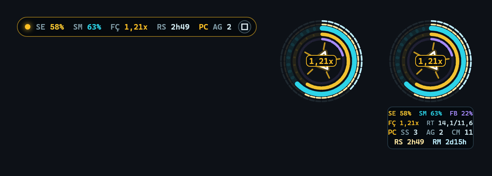
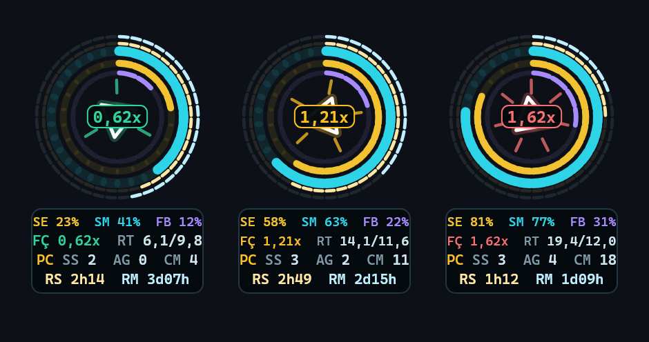

# Medidor de Cota do Claude

**Um medidor ao vivo da sua cota do Claude Code, sempre por cima, na área de trabalho.** O Reator Mark II flutua sobre a
sua tela e mostra a janela de 5 horas e a semanal, quando cada uma reinicia, e a **força**: o quanto você
está gastando comparado com o que ainda cabe até o reinício. Abaixo de 1x fica calmo e verde. A partir de 1x fica âmbar e
acelera. A partir de 1,4x fica vermelho.



> **Não oficial.** Sem ligação nem endosso da Anthropic. "Claude" e "Claude Code" são marcas da Anthropic.

[English](README.md) · Feito pela [3BRAIN](https://3brain.com.br) com o Claude Code

---

## O que mostra

| | |
|---|---|
| **5 h · 7 d** | quanto de cada janela você já usou (os anéis dourado e ciano) |
| **Semana por modelo** | o anel violeta, com a leitura exata ligada (veja abaixo) |
| **Reinícios** | quanto falta para cada janela reiniciar (os anéis finos de dentro e de fora) |
| **Força** | o seu ritmo real de gasto ÷ o ritmo que ainda cabe até o reinício, da janela que bate no teto primeiro. É ela que dá a velocidade e a cor do holograma. |
| **Ritmo** | %/hora que você gasta de verdade e %/hora que cabe (a semana conta horas trabalhadas: jornada de 8 h) |
| **Este PC** | sessões do Claude Code abertas, subagentes em voo e chamadas ao modelo por minuto, e um clarão a cada chamada. Esta linha nunca entra na força nem na cor. |

Quando a força passa de 1x, o medidor muda de cor, pisca devagar e, se estiver minimizado, abre sozinho. Clique com o
botão direito para trocar o tamanho ou ver a legenda.

## As três aberturas

| | tamanho | |
|---|---|---|
| **Minimizado** | 348 × 30 px | uma pílula com sessão, semana, força, reinício da sessão e subagentes |
| **Semi-aberto** | 130 × 130 px | só o reator; os números ficam escondidos no botão das três linhas |
| **Aberto** | 130 × 208 px | o reator com o painel de números por baixo |

Os botões da janela e o duplo clique passam de uma para outra, e a escolha fica guardada.



## Requisitos

- Windows 10 ou 11 (a janela é uma janela Win32 nativa, transparente pixel a pixel)
- Python 3.10+
- Claude Code **2.1.80 ou mais recente**, num plano **Pro ou Max** do claude.ai. Foi a partir dessa versão que o Claude
  Code passou a entregar a cota à linha de estado.

## Instalar

```bash
git clone https://github.com/fabiocdssilva69-prog/claude-quota-meter
cd claude-quota-meter
pip install -r requirements.txt
```

### 1. Alimente pela linha de estado (padrão, oficial, sem token)

Em cada resposta, o Claude Code entrega ao script da linha de estado o campo oficial `rate_limits` (uso e reinício das
janelas de 5 h e de 7 dias). O gancho guarda uma leitura a cada passo de 3 minutos e imprime um resumo curto. Coloque isto
no `~/.claude/settings.json` (com o caminho da sua pasta):

```json
{
  "statusLine": {
    "type": "command",
    "command": "python C:/caminho/para/claude-quota-meter/quota_meter/statusline.py",
    "refreshInterval": 60
  }
}
```

A sua linha de estado vai mostrar `5h 23% · 7d 41% · resets 2h14`. O `refreshInterval` mantém as leituras a chegar com a
sessão parada.

**Já tem uma linha de estado?** Mantenha a sua e, de dentro do seu script, passe o mesmo JSON ao gancho em modo silencioso:
`python .../quota_meter/statusline.py --quiet`.

### 2. Abra o medidor

```bash
pythonw -m quota_meter            # abre (sem consola)
pythonw -m quota_meter --toggle   # abre ou fecha (bom para um atalho na área de trabalho)
python  -m quota_meter --state    # uma leitura em JSON
python  -m quota_meter --probe saida          # desenha as três aberturas com os seus números reais
python  -m quota_meter --probe saida --demo   # o mesmo com números de exemplo nas três zonas da força
```

Arraste-o para onde quiser. O botão `-` (ou um duplo clique) encolhe-o numa pílula só com os números, e o botão das três
linhas esconde os números e deixa só o reator.

## Opcional: a leitura exata (não oficial)

A linha de estado não traz a janela semanal por modelo e só atualiza enquanto o Claude Code responde. Se quiser as duas
coisas, ponha `"fonte": "oauth"` no `~/.claude-quota-meter/config.json`. O medidor passa então a perguntar ao endpoint que
o próprio Claude Code usa para o `/usage`, no máximo uma vez a cada 3 minutos e com recuo quando é recusado.

> **Leia antes.** Esse endpoint **não é uma API pública documentada**: pode mudar ou deixar de funcionar sem aviso. O
> medidor lê o token OAuth que o Claude Code guarda em `~/.claude/.credentials.json` no momento de cada pedido, envia-o
> **só** para `api.anthropic.com` e nunca o imprime, regista ou guarda. Fica desligado até você o ligar.

## Configuração

`~/.claude-quota-meter/config.json` (criado na primeira vez):

| chave | padrão | |
|---|---|---|
| `tamanho_px` | `130` | tamanho: 130 micro, 180 pequeno, 260 médio, 340 grande |
| `fps_max` / `fps_repouso` | `30` | quadros por segundo com e sem chamadas |
| `teto_cpu_nucleo` | `0.12` | fração de UM núcleo que o desenho pode gastar (0,12 ≈ 1% de uma máquina com 12 núcleos) |
| `fonte` | `statusline` | `statusline` (padrão) ou `oauth` (opcional, veja acima) |

## Privacidade

- **Lê:** as leituras que o gancho guardou, os transcritos do Claude Code em `~/.claude/projects` (só para o pulso, as
  sessões e os agentes) e, se você ligar, o endpoint de uso.
- **Escreve:** só em `~/.claude-quota-meter/` (`history.jsonl`, `resets.json`, `config.json`, `estado.json`, `medidor.log`).
- **Nunca** chama um modelo, nunca envia os seus dados para outro lugar e nunca precisa de uma chave de API.

## Como se calcula a força

Cada leitura cai numa grade comum de 3 minutos (UTC). O **ritmo** de uma janela é o quanto ela subiu de verdade nos
últimos 40 minutos (janela de 5 h) ou nas últimas 24 horas (semana), só com pontos da grade. O que **cabe** é o que resta
da janela dividido pelas horas até o reinício (na semana, horas trabalhadas). **Força = ritmo ÷ o que cabe**, da janela que
chegaria aos 100% primeiro. Com as mesmas leituras, duas máquinas mostram exatamente os mesmos números, e os testes provam
essa propriedade da grade.

## Testes

```bash
pip install pytest hypothesis
python -m pytest tests -q
```

53 testes, incluindo propriedades Hypothesis: a força nunca quebra com `None`, 0% ou 100%; duas máquinas com as mesmas
leituras concordam; o gancho grava exatamente uma leitura por passo da grade.

## Licença

[MIT](LICENSE) © 2026 3BRAIN
